English | [简体中文](./README.md)

# Elemental Sandbox

A skillshot VFX sandbox built with **Three.js**, **Vite** and hand-written **GLSL**.

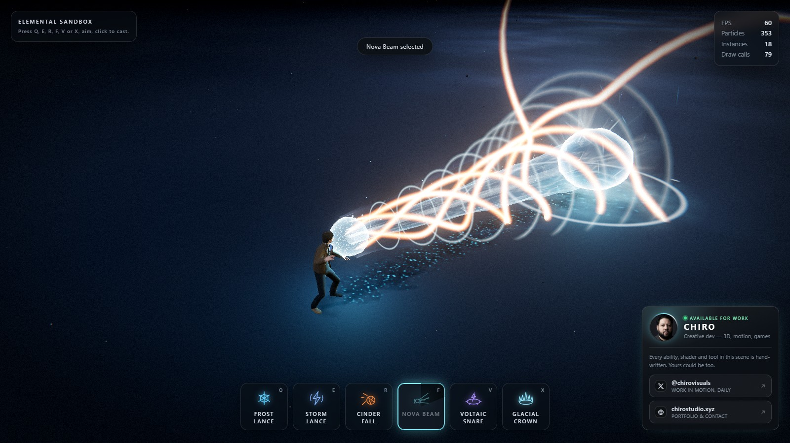

Nine abilities and three ways to aim them. Four are **line casts**: press the key to arm, a
League-of-Legends style arrow appears on the ground and swings with the mouse, click to fire. Three
more are **far casts**: the arrow is replaced by a circle with a deliberately thick boundary that
follows the cursor and answers the only question a ground-targeted AoE has to answer before you
commit — how much space is this going to take. The last two are **hold casts**: a circle aims them
too, but aiming is all that circle does — the cast itself happens during the time you keep the left
button down. **Z** charges a singularity that grows wider and harder the longer you hold it, **N**
channels a lightning tether that welds itself between the caster's hand and the cursor and follows
it. Nothing is spent until you let go, and `Esc` or a right click interrupts either one without
paying for it.

<p>
  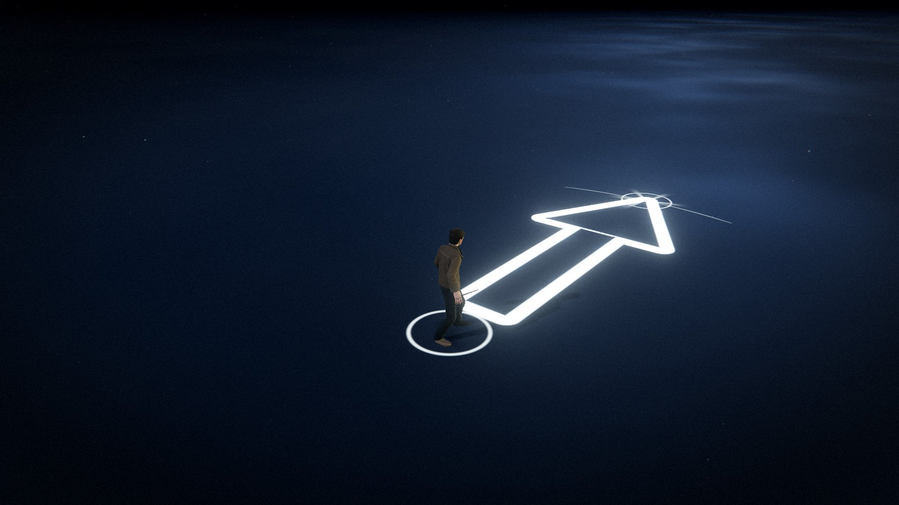
  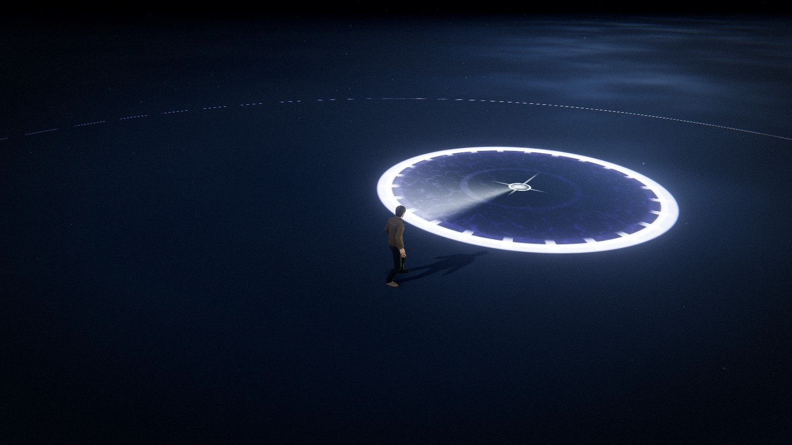
</p>

**Q — Frost Lance.** A fracture front races out along the line while a field of ice crystals
tears up out of the floor behind it — small and dense at your feet, opening into a wall of blades
at the far end, with a cluster thrown up around the impact point.

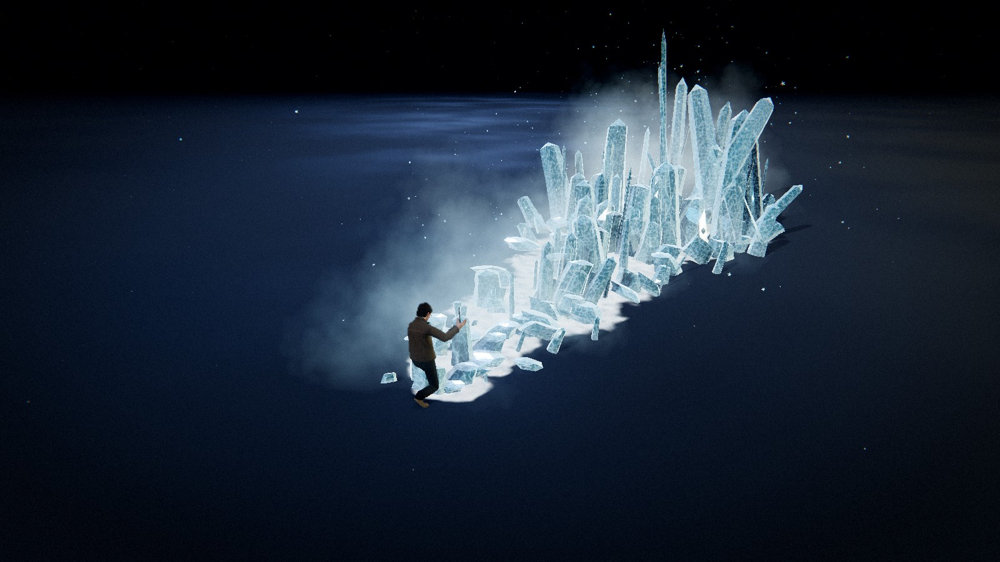

**E — Storm Lance.** A bolt leaves the caster's hand and a bundle of lightning filaments is drawn
out behind the strike front, holds while it gutters and re-strikes, then blows out. Sparks come
off it the whole way, the floor underneath takes a branching electric burn and a dark scorch, and
the far end gets a shell of ionised air.

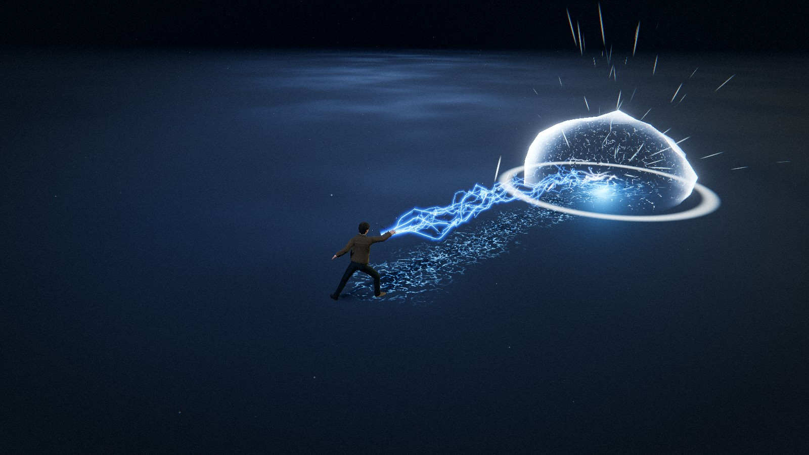

**R — Cinder Fall.** A burning rock is lobbed downrange on an arc, trailing a raymarched wake of
burning gas and heating up the whole way: the lava seams splitting its surface prise wider and
brighter as it comes in. It detonates on arrival, throws its own shattered chunks across the floor, and tears the
ground open into a network of molten cracks that keep glowing while the crater burns out.

<p>
  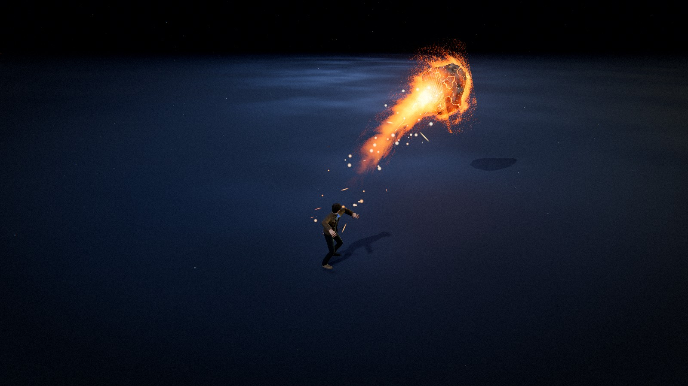
  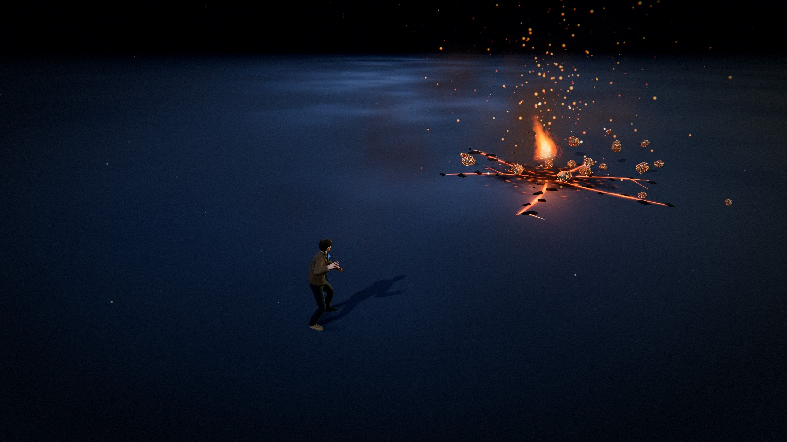
</p>

**F — Nova Beam.** The caster winds a ball of light up in both hands, pulling motes in out of the
air, then lets a column of it out along the line — white-hot core, cyan sheath, gold ribbons
spiralling around it and shock discs racing down it. It *holds* there, burning into the floor and
throwing spray back up the beam, before collapsing to a thread and blinking out. The only cast in
the sandbox that is still happening a second after it landed.

<p>
  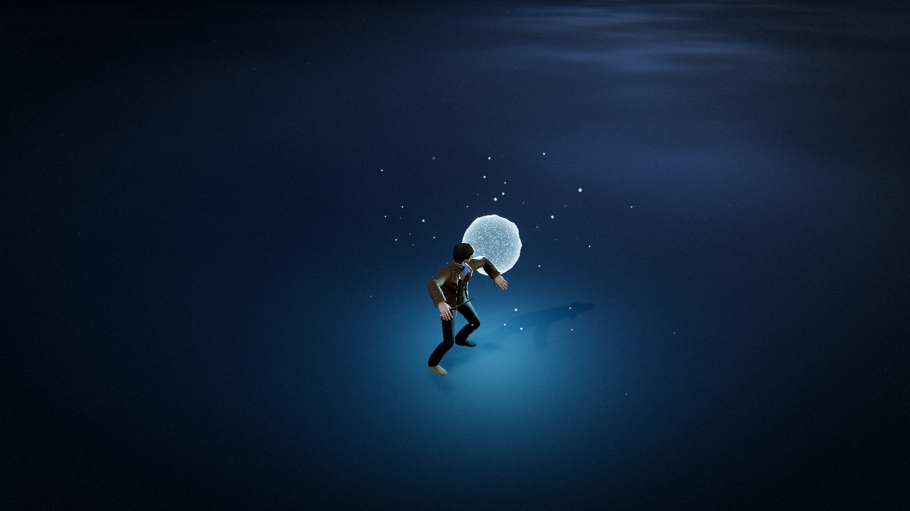
  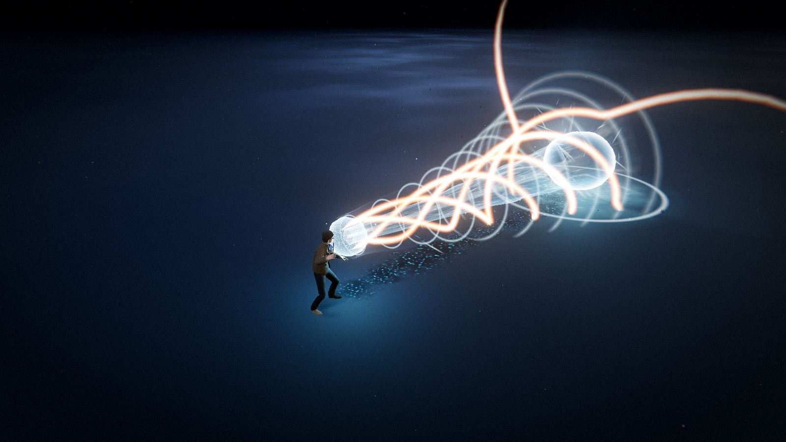
</p>

**V — Voltaic Snare.** The first far cast. A leash of current is whipped out across the floor, and where
it lands the ring snaps open past its own radius and pulls back onto it: a violet column tears up
out of the middle, tendrils crawl outward to the boundary, arcs run around the rim and the whole
disc burns. It holds there re-striking and hauling the air up into the pillar, then collapses to a
thread. The circle you measured out before the click is exactly the circle you get.

<p>
  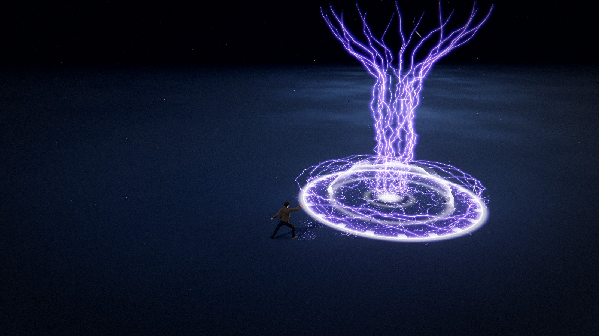
  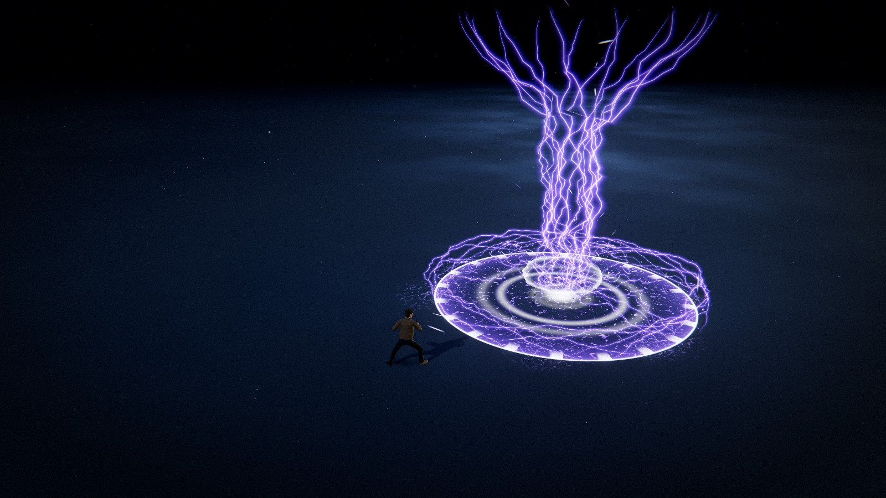
</p>

**X — Glacial Crown.** The second far cast, and the snare's opposite answer to the same circle. A
cold front races across the floor to the point, the disc freezes out to the boundary, and a ring of
crystal blades tears up out of the ground around it — the blade nearest the caster first, the wave
running round both sides to close behind — with a skirt of wreckage banked against their feet. The
middle stays open: the read is a wall you are looking into. It stands there glinting and breathing
cold off its rim, then shatters plate by plate and sinks back into the floor.

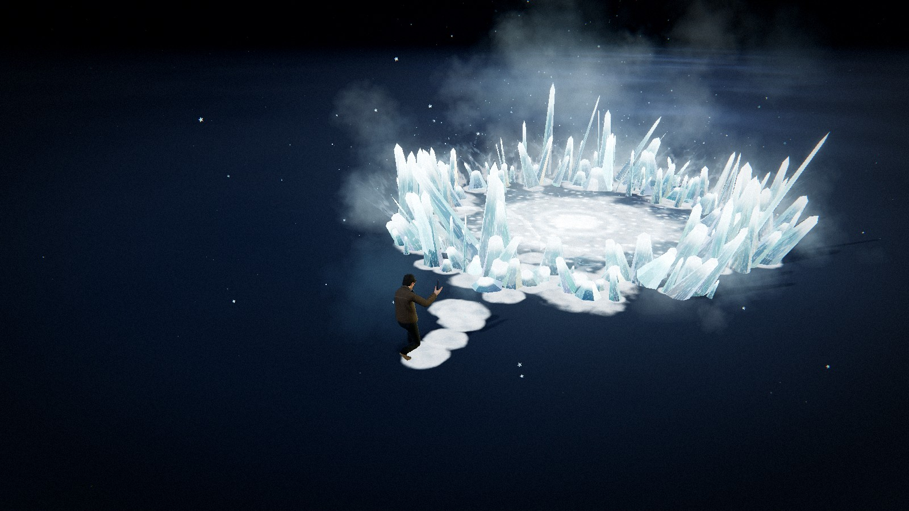

**B — Banknote Storm.** The third far cast. A cyclone of ¥100 notes tears open at the aimed point:
the notes fill the footprint, swirling, fluttering and slowly climbing — and when the storm lets
go, they spiral outward and flutter down like leaves.

**Z — Implosion.** The first hold cast. Press and hold the left button and a disc opens on the
ground under the cursor: it grows from 3.2 m out to 9 m, its boundary band, tick marks and interior
fill writing out how much space this is going to take in real time, until the singularity matures
and swallows the middle of its own marker. Nothing happens until you release — two seconds of charge
carries both radius and damage to their ceiling (140 to 460), while a quick tap is a poke at the
floor of that range: there is no minimum press — a tap fires immediately, just at minimum
power. The camera pushes in toward the landing point as the charge builds, so the room has already
begun to darken before you let go.

**N — Tether.** The second hold cast, and the first damage source in the sandbox with no travel time
and no footprint to place — it is a steering wheel rather than a shot. Hold, and an arc of lightning
welds itself from the caster's hand to the point on the ground under the cursor and follows it as you
move: the hand is steady, the chaos lives at the anchor. Anything caught along that line is chewed at
26 damage every 0.12 s. Let go and it snaps with a discharge at the far end. Its numbers are per-tick
and modest, which is exactly why it hurts to stand inside.

Everything you can see is generated. There are no textures, no sprite sheets and no meshes on
disk except the character and the two banknote scans: the crystals are procedural geometry, the
bolt is a strip of ribbon placed entirely by a vertex shader, the meteor is an icosphere cratered and sliced by fracture
planes on the CPU, the beam is a parametric tube drawn three times at three radii, the snare's
whole cage is that same ribbon strip threaded along four different parametric paths, the arrow, the
targeting circle, the rime, the burns and the molten cracks are signed-distance and noise shaders,
and the mist, sparks, chips and glitter are GPU particles.

**Every parameter is a live slider** — 1325 of them — and they stay live while the simulation is
paused. That is the point of the project: freeze a frame mid-eruption, mid-strike or mid-burn with
**P**, then reshape the silhouette, the palette and the timing against a still image.

References for the look: `icecast.jpg`, `thundercast.jpg`, `superbeam.jpg` and
`electricalboost.jpg`.

---

## Minion waves

The stage is not empty. With **M** (or the toggle beside the ability bar) on, a wave director keeps
sending small creatures up out of the floor around the character to converge on you — and then to
hit back:

- **Waves** — every ~2.6 s a small wave (3 by default) emerges on a ring 19 m out, capped at 24
  alive; a separation pass pushes neighbours apart, so they form a ring rather than a stack.
- **Health bars** — one billboard bar per minion, the whole swarm costing **one** instanced draw
  call. Hidden at full health, shown for ~2.2 s after a hit, with a white trailing segment where
  the health just was.
- **Damage** — all nine abilities hurt them: line casts sweep a segment from the previous front to
  the current one (fast bolts cannot tunnel through a body), far casts strike on landing and keep
  ticking while they stand, the beam burns its ground track at a DPS while it holds, and the two hold
  casts settle by charge and by tick. Hits carry lateral falloff and crits.
- **Feedback and death** — a hit flashes the body white, shoves it along the blow and staggers it
  briefly; at zero health it topples along the blow, pauses, sinks back into the floor and puffs
  into dust, then returns to the pool — zero garbage over a long session.
- **They hit back** — a minion in reach bites on its own `interval` clock, leaning visibly forward
  for the 0.28 s `attack.windup` before the bite lands for 8 damage. Stepping out of that circle
  winds the clock back, so re-engaging is never an instant bite: the threat is something you can walk
  out of.
- **The ranged caste** — 22% of each wave (`ranged.share`) comes up as a thrower instead. It holds at
  8.5 m rather than closing and lobs a bolt every 2.6 s — one pooled additive sphere with a particle
  trail, and it only ever threatens the player. It never bites; its whole threat is the ball it keeps
  tossing from safety, and that is what takes "stand still and cast" off the table.
- **The boss** — every 5th wave arrives led by one body: 14× health (1400 points), 2.1× scale, speed
  cut to 0.72×, so it lumbers. Every 7 s it **inflates by 42%** as its tell, then drops a 5 m ground
  slam — 0.7 s of wind-up, 24 damage if you are standing inside the ring. The landing shakes the camera
  whether or not it caught you, because the ground is the event and the damage is only the receipt. It
  comes out of the same minion pool and costs nothing extra; only its dice are bigger.
- **Tuning** — the editor's Minions folder adjusts waves, movement, health and damage, bite, ranged,
  boss, death, looks and the health bars live — including while paused (**P**). Each of the three
  counter-attack rhythms has its own sub-folder, so the bite interval, the thrower share and the
  inflate tell can all be dragged while a brawl is happening.

Each ability carries its own damage numbers (`hitDamage` / `hitWidth` / `tickDamage`…) in its own
settings block, and `damageTaken` is the global difficulty dial. The HUD shows the live minion count,
the kills, the wave number and your gold top-right.

---

## Player movement and health

The character used to be the origin of the world: it stood still while the world happened around it.
Now it has a body — it walks, it bleeds, and it turns a somersault.

**WASD** (or the arrow keys) moves it at 4.4 m/s, **relative to the camera**: W is always "away from
the camera", whichever way you have orbited, and diagonal input is normalised so running at an angle
is not faster. The arena is held by `groundRadius` at 24 m: past that the position is eased back
toward the origin — no wall, just a soft edge.

Health is 100 points (`maxHp`), regenerating at 2 points a second once 5 seconds have passed without
a hit (`regen` / `regenDelay`). Both numbers are deliberately sleepy: enough to be full again between
two waves, not enough to outlast a gang-up. A hit flashes the screen, shakes the camera and hands you
0.5 s of invulnerability (`hurtInvuln`) — just long enough to squeeze back out of the bite range.

**Space is the dodge.** It is a 16 m/s shove lasting 0.16 s (`dashSpeed` / `dashTime`) on a 1.5 s
cooldown (`dashCooldown`), and for the first 0.3 s of it you have i-frames (`dashInvuln`) — so
**dashing through** an attack genuinely works: a hit that checks while that window is open passes
straight through. A full somersault rides on top of the shove: `rollTime` is 0.34 s, longer than the
dash itself, the body tucks and flips a complete turn about its own right axis and peaks 0.6 m off
the floor (`rollHeight`), so it lands back on its feet *after* the momentum has spent itself. The
flip runs on its own clock, which is exactly why it can finish rolling before it stands up. Dying
mid-roll stands the flip down and lets the fall take the posture over.

At zero health the character goes down and a card comes up with the run's numbers — kills, waves
survived, gold picked up. **Enter**, or the button on the card, starts a new run: gold and all four
upgrade levels go back to zero, the swarm is cleared and the loot returns to the pool.

---

## Loot and the shop

Every minion death drops gold — 1 to 3 coins (`goldMin` / `goldMax`) — and 8% of the time
(`healChance`) it drops an orb worth 20 health instead. Coins sink away after 25 s (`goldLife`), are
magnetised inside 2.6 m (`magnetRadius`) and collected inside 0.9 m (`pickupRadius`). The moment
there is gold on the floor, the floor reads as an economy: a coin accelerating toward you is most of
the dopamine loop. The boss is the exception — it drops a flat 10 coins worth 6 each (60) and never a
heal orb.

**T** opens the shop, and opening it pauses nothing. Four flat tracks, each level a plain multiplier:

- **Spell power** (`damagePerLevel`) — +15% damage per level.
- **Haste** (`cooldownPerLevel`) — −8% cooldown per level, floored at 0.35× so it never reaches zero.
- **Vitality** (`vitalityPerLevel`) — +25 max health per level, paid back immediately as a heal, so
  the purchase is felt at once.
- **Pace** (`pacePerLevel`) — +10% move speed per level, with the pickup magnet widening by the same
  fraction: one track buys two feelings.

The next level of every track costs `baseCost × costGrowth^level` — 20 to start, 1.6× each time — so
the curve bites by the third purchase. Buying plays the pickup sound and refreshes the panel in
place; a track you cannot afford is simply dimmed.

---

## Element reactions

Every hit brands a minion with the element that landed, and the brand is remembered for
`reactions.window` — 2 seconds. Hitting that same body with a **different** element inside the window
detonates a reaction: the second hit takes a multiplier and the brand is consumed. One memory, one
reaction — no single ability can chain-stun a crowd.

Three layers resolve a pair, most specific first: the **hand-written pairs**, then the **family
matrix**, then plain **resonance**. Nine elements make thirty-six pairs, and all thirty-six land
somewhere — none of them was forgotten.

Layer one is the hand-written table. These are the reactions the sandbox is known for, and they win
over everything below them:

| Pair | Reaction | Bonus |
| --- | --- | --- |
| ice + thunder | 超导 (Superconduct) | ×1.5 |
| ice + meteor | 蒸爆 (Steam Burst) | ×1.35 |
| meteor + thunder | 感电 (Conducted) | ×1.4 |
| beam + ice | 霜辉 (Frost Shine) | ×1.3 |
| glacier + thunder | 电网 (Grid) | ×1.35 |

Layer two is the family matrix. Every element belongs to exactly one family, and each pair of
families has a phenomenon:

| Family | Members | | Family pair | Reaction | Bonus |
| --- | --- | --- | --- | --- | --- |
| frost | ice, glacier, beam | | frost × storm | 超导 (Superconduct) | ×1.5 |
| storm | thunder, snare, tether | | frost × ember | 蒸爆 (Steam Burst) | ×1.35 |
| ember | meteor | | storm × ember | 感电 (Conducted) | ×1.4 |
| arcane | banknote, implosion | | frost × arcane | 霜蚀 (Frostbite) | ×1.35 |
| | | | storm × arcane | 过载 (Overload) | ×1.45 |
| | | | ember × arcane | 燃荒 (Wildfire) | ×1.4 |

Layer three is **共鸣 (Resonance)**: two elements of the *same* family meeting — ice and beam, say —
produce no new phenomenon and fall back to ×1.35 (`reactions.bonus`), without a name. That is a rule,
not a hole in the table: more of the same element is more of the same element. And two hits of one
element never react at all — `reactionOf(a, b)` returns null when `a === b`.

Layer one has to exist because the family layer is coarser than the fiction: ice and glacier are both
frost, but they meet lightning differently (超导 ×1.5 against 电网 ×1.35), and beam + ice is a
same-family pair that still has a name of its own. What the family layer buys is the cost of adding an
ability — one line under `families` inherits the whole thirty-six-pair matrix instead of eight new
rows. A family pair's colour is not a constant either; it is blended from the two element accents that
met.

All three layers live in `settings.reactions` (`pairs` / `families` / `vs`), so the eleven bonuses are
live sliders under **Growth → Element reactions** and travel with a preset — this table used to live
outside `settings`, which made it the one set of numbers in the project you could not drag.

The bonus lands on the second hit only: it is a damage multiplier and nothing else, carrying no stun
and no displacement. The whole visible feedback is one burst of sparks at the body, tinted to that
reaction's colour, plus its sound — which is also why reactions never appear on the HUD, and why
"brand it with ice, then land a bolt" is the only reason in the sandbox to order your casts.

---

## Sound

`src/audio/Sound.js` is the only line of audible code in here, and it is the sequel to "nothing on
disk": there is not a single audio file. Every sound is synthesised at runtime from oscillators and a
one-second noise buffer, shaped by filter and gain envelopes and pushed through a `DynamicsCompressor`
(threshold −18 dB, ratio 8) — because a stack of casts landing together would otherwise clip the whole
mix flat, and the compressor turns that into one shove instead of a crackle.

It is a singleton (`sfx`) for the same reason `frame` is: sound is a service, not a system. The HUD,
the abilities, the minions and the camera shake all import the same `sfx` and call one verb on it, and
the WebAudio nodes are throwaway — built for a single sound and left to the collector after `stop()`,
so nothing is allocated per play.

The chain is `master → compressor → destination`, and the master rides over four channels: `cast` (a
spell leaving the hand), `impact` (what the camera shake is answering), `combat` (minions and the
player trading blows) and `ui` (cards, coins, the dodge). Every sound reads `settings.audio` as it
plays, so the editor's faders really are a mixing desk — pull `impact` down while a cast is still in
the air and it goes quiet.

An AudioContext can only be created on a user gesture, so `sfx.unlock()` is bound to the first
pointerdown or keydown on the window; until then every call is a silent no-op — the loading screen is
genuinely quiet, and the world only starts making noise after the first click.

The verbs are named for what they mean rather than for a file — `cast(element)` (a distinct patch per
element: glass and air for the ice, a crack for the bolt, a low roll for the meteor, a wind-up for the
beam, paper being fanned for Banknote Storm), `impact(amount)`, `hit`, `death`, `hurt`, `dash`,
`pickup`, `heal`, `boss`, `ui`, `holdStart(element)`, `channelTick`, `reaction`, `gameOver`. When two
dozen minions are hit in the same frame, each name carries a rate gate of its own (`_gate`), without
which all those hits would stack into one long click. The **Sound** folder in the editor is that
mixing desk, with the faders right there.

---

## Quick start

```bash
npm install
```

```bash
npm run dev
```

Then open the URL Vite prints (default <http://127.0.0.1:5173>).

```bash
npm run build
```

```bash
npm run preview
```

### Assets

The following binary assets are served from `public/` and loaded automatically at boot:

| File | Purpose |
| --- | --- |
| `public/models/Idle.fbx` | Rigged character **and** its idle animation clip |
| `public/models/diffuse.png` | The character's colour map |
| `public/models/cast1.fbx` | Cast animation |
| `public/models/cast2.fbx` | Cast animation |
| `public/models/cast3.fbx` | Cast animation — the default for Frost Lance, Voltaic Snare and Glacier Crown |
| `public/hdri/spruit_sunrise.hdr` | HDR probe used for image-based lighting and crystal reflections |
| `public/banknotes/cn-100-*.png` | Front and back scans for Banknote Storm |

All four FBX files are Mixamo exports of the same rig, each carrying a skinned mesh plus one
animation stack. The character comes from the idle file; the cast files are loaded for their clip
alone, and the duplicate rig that arrives with each one is released the moment its `AnimationClip`
has been taken. Clips bind to the skeleton by bone name, which is the whole reason an animation
authored in another file plays here without retargeting.

The rig ships no material, so `diffuse.png` is loaded beside it and assigned as the colour map when
the imported materials are converted to PBR — an FBX that *does* carry an embedded texture keeps its
own, since that map is authored against its own UVs.

Every ability picks the clip it throws — `castAnim` in its settings block, a dropdown under **The
cast** in its editor folder. Out of the box slots 1, 5 and 6 — Frost Lance, Voltaic Snare and Glacier
Crown — throw `cast3`, and the other three throw `cast1`. The clip is a one-shot laid over
the looping idle, with `character.castBlendIn` / `castBlendOut` as the two edges of that overlap.

The HDR is loaded as image-based lighting and as the reflection source for the ice — it is never
shown as a visible sky. The stage keeps its flat dark backdrop.

---

## Controls

| Input | Action |
| --- | --- |
| **Q** (or **1**) | Arm Frost Lance — press again to put it away |
| **E** (or **2**) | Arm Storm Lance — press again to put it away |
| **R** (or **3**) | Arm Cinder Fall — press again to put it away |
| **F** (or **4**) | Arm Nova Beam — press again to put it away |
| **V** (or **5**) | Arm Voltaic Snare — a far cast, aimed with a circle |
| **X** (or **6**) | Arm Glacial Crown — a far cast, aimed with a circle |
| **B** (or **7**) | Arm Banknote Storm — a far cast, aimed with a circle |
| **Z** (or **8**) | Arm Implosion — a hold cast: press and hold the left button to charge, release to fire |
| **N** (or **9**) | Arm Tether — a hold cast: press and hold the left button to channel, release to snap |
| **W A S D** / **arrow keys** | Move — camera-relative, diagonals normalised |
| **Space** | Somersault dodge — a 16 m/s shove with brief i-frames |
| **Move the mouse** | Swing the aim arrow, or move the far-cast and hold circle |
| **Left click** | Cast along the arrow, drop the circle where it is, or charge a hold cast |
| **Esc** / **right click** | Cancel an armed cast — or interrupt a hold in progress, spending nothing |
| **Right mouse + drag** | Orbit the camera |
| **Scroll** | Zoom |
| **T** | Open / close the shop |
| **Enter** | Confirm — and start a new run from the death card |
| **G** | Show/hide the VFX editor |
| **P** | Pause / resume — *the editor keeps applying* |
| **C** | Clear all active effects |
| **M** | Show/hide the minions |
| **H** | Hide the controls panel |

`range` and `minRange` are per ability, so the indicator's reach changes with the slot you have
selected. Aiming closer than the selected ability's `minRange` tints it red and refuses the cast;
set `minRange` to 0 if you would rather cast at your own feet, which is what the Snare ships with —
a trap you cannot drop on yourself is missing half its uses. Cooldowns are per ability too, so
spending one slot never locks the other out. A hold cast's charge is measured on **real** time, so
pausing never lets a charge mature behind your back.

---

## Project layout

```
src/
  abilities/      Ability base class (the travelling front) and HoldAbility (hold casts),
                  the nine abilities, the pooling manager
  animation/      FBX character loading, AnimationMixer, the per-ability cast clips,
                  the procedural cast lunge and somersault
  assets/         Procedural crystal and asteroid geometry, the bolt ribbon strip,
                  the beam tube and its shock discs
  audio/          Runtime-synthesised sound — oscillators and noise, no audio file on disk
  config/         settings.js — the single source of truth for every parameter
  core/           App, Renderer, CameraRig, Time, Layers, shared frame uniforms
  effects/        Aim arrow, far-cast circle, ground decals, fissures, bursts,
                  light pool, shake, flash
  game/           Player (health, upgrades, the somersault), Drops (gold and heal orbs)
  input/          InputManager (events) and AimController (two indicators, one controller)
  loaders/        AssetLoader with a shared LoadingManager
  materials/      IceMaterial, LightningMaterial, MeteorMaterial,
                  VolumetricFireMaterial, BeamMaterial, SnareMaterial, and friends
  minions/        The minion itself, the wave manager, the instanced health bars
  particles/      GPU particle system + engine and rate emitters
  postprocessing/ Composer pipeline, grade shader, distortion shader
  shaders/lib/    Shared GLSL: noise library, common helpers
  ui/             HUD (ability bar, health bar, shop, death card), lil-gui editor,
                  preset manager, contact.js (the card), glyphs.js (ability sigils), styles
  utils/          Maths, colour cache, pooling, disposal, shader patching
  world/          Environment (stage lighting), floor, dust, contact shadows
  archive/        The retired four-element sandbox — see archive/README.md
```

---

## How it fits together

### Settings are the API

`src/config/settings.js` holds every tweakable value. Nothing else owns that state: shaders,
particle systems, lights and post passes *read* those objects every frame. That is what makes the
editor work with no rebuild — moving a slider changes the ice field that is already standing, the
next cast, the environment and the post stack at once. Preset loading deep-merges *into* the same
objects so every live binding stays valid.

```js
import { settings } from './config/settings.js';
settings.ice.height = 7;          // visible on the next frame, even mid-cast
settings.thunder.jitter = 1.2;    // re-kinks a bolt that is already in the air
settings.global.timeScale = 0.1;  // slow the whole cast to a crawl
```

Ability blocks are keyed by their id in `ELEMENTS`, and the shared systems that need to know
"which ability is the player holding" — the aim controller, the cooldowns, the HUD — look it up as
`settings[element]`. The four fields they rely on being present are `range`, `minRange`, `speed`
and `cooldown`; a far cast adds a fifth, `zoneRadius`. Everything else in a block is that ability's
own business.

### The rule that makes "edit while paused" work

A spike record in `IceAbility` stores **only what the dice decided**: a position *fraction* along
the line, a signed lateral *fraction*, and a handful of unitless jitters. Not one metre, radian or
second is captured when the cast starts. Every dimension is resolved against `settings.ice` inside
the update loop, which runs on a zero-length frame too.

So dragging `height` re-grows a field that is already standing; dragging `lean` re-tilts it;
dragging `clumping` re-packs it toward the centre line. The only values a record *does* capture
are timestamps — the moment its own eruption was triggered. Those are events, not dimensions.

The four *shape* controls (`facets`, `taper`, `roughness`, `bend`) cannot be expressed as a
per-instance transform, so they are baked into the geometry instead — and a six-sided crystal is
just 60 triangles, cheap enough to regenerate outright rather than approximate in a vertex shader.
`IceAbility#_syncGeometry` hashes those four values and rebuilds the three crystal meshes when the
hash changes, which is what keeps them live sliders rather than restart-required constants.

### Aiming

`AimController` raycasts the pointer onto the ground plane **every frame**, not only on mouse
move, so orbiting the camera with a cast armed swings the indicator under a stationary cursor. It
clamps the distance into `[minRange, range]`, tracks a 0..1 reveal envelope, and emits a single
`cast` event carrying an origin, a unit direction and a distance — which is exactly the signature
`Ability#spawn` takes. It decides nothing about what the cast does.

It runs on **real** time rather than the scaled simulation delta, so the indicator keeps animating
while the sandbox is paused.

There are two indicators and one controller. Which one is drawn comes from
`ELEMENT_META[element].cast` — `CastShape.LINE` or `CastShape.ZONE` — and that is the *only* thing
the two indicators disagree about. Arming, clamping, validating, revealing and firing are shared, and
both end in the same three-argument `cast` event, because from the targeting side a far cast is a
line cast you only care about the far end of. That is why zone targeting needed no change in
`Ability`, `AbilityManager` or `App`: `SnareAbility` reads its centre as `pointAt(1)` and works
outward from there.

A **hold cast** folds that mechanism once. `press` stops meaning `confirm`: for an ability whose
settings say `holdToCast`, holding the left button emits `holdstart` and *keeps the aim armed*, and
`App` pushes the point the cursor resolves to down to the ability every frame — so it keeps tracking
even while you hold still. Letting go emits `holdend` carrying the seconds the button was down, and
that is the entire charge mechanic. `Esc` or a right click emits `holdcancel` instead: an aborted
hold spends nothing, which is the deal the mechanic makes. It is aimed with a circle like the far
casts, but what actually expresses its footprint is the marker the ability draws on the ground
itself — the singularity's spread grows from 3.2 m to 9 m with the charge, because "how much space
is this going to take" is not settled yet while you are holding it.

### The far-cast circle

`ZoneIndicator` is the arrow's opposite number, and it is built out of the same two ideas: metres,
and no textures.

The **footprint** is one quad whose fragment shader remaps UV into metres from the target, so the
boundary stays 0.34 m thick whether the circle is 2 m or 8 m across. The band is deliberately the
heaviest mark on screen — it is the whole message — and it is split about the nominal radius by
`boundaryBias` rather than centred on it, so its *outer* lip stays honest about where the effect
ends. Inside there is a rim-weighted wash, contour rings travelling outward, warped filaments and a
reticle whose downrange arm is longer, because the quad carries the caster's yaw and that arm is
therefore the heading.

The **reach ring** at the caster is the bolt's ribbon strip bent into a circle: `(t, side)` in,
world position out. A quad big enough to hold a 20 m range would be 40 m across and shade a
screenful of discarded fragments for one thin line.

The circle **snaps out past its radius and settles back** when the cast is armed, and the trap does
the same thing when it lands. A circle that grows linearly reads as a UI element; one that
overshoots reads as something the caster did.

### The arrow is one SDF

`AimIndicator` is a single ground quad. Its fragment shader remaps UV into **metres measured from
the caster**, so every control in `settings.aim` is a real measurement — the shaft stays 0.42 m
wide whether the cast is 3 m or 15 m long.

The silhouette is a rounded union of a box (the shaft) and iq's exact triangle SDF (the head);
the cheap half-plane intersection leaves visible corner artefacts on a wedge this shallow. From
that one distance field the shader derives the outline, the rim-weighted interior wash, the
chevrons (a phase skewed by `|x|`, which turns flat bands into arrowheads pointing the way the
cast does), the frost noise and voronoi plates, the ring at the caster's feet, the range cap arc,
a six-fold frost rosette pinned to the impact point, and the sweep-out when the ability is armed.

### The ice

`materials/IceMaterial.js` patches a `MeshStandardMaterial` rather than replacing it, so the
crystals cast and receive the stage's real shadows and pick up the HDR probe. The stylisation is
injected on top:

- **Thickness tint** — a facet seen head-on has the longest path through the crystal, so it
  darkens toward `colorDeep`; grazing edges stay pale. This is the term that makes the field read
  as a solid you can see *into* rather than as blue plastic.
- **Internal fracture** — ridged noise sampled in **world** space, so the crack planes stay a fixed
  physical size whether a spike is ankle-high or three metres tall, and neighbouring crystals look
  quarried from the same block.
- **Feather frost and rime** — fbm sampled in **local** space (0..1 up the crystal), so the milky
  veining and the frost creeping up from the base follow each spike's own axis however it is
  scaled or leaned.
- **Glint** — a hard-thresholded high-frequency field scrolling in world space, biased toward
  grazing angles, which is where real ice catches.
- **Birth flash** — a per-instance attribute the ability drives from 1 to 0 over `birthFade`, so a
  crystal is lit from within for the moment it erupts.

Three `InstancedMesh`es share one material. Three rather than one because the *facets* differ, not
just the proportions — per-instance scaling alone cannot buy that silhouette variety, and three
draw calls is a cheap price.

### The lightning

`ThunderAbility` takes the "no dimensions on the CPU" rule further than the ice does: there is no
path object at all. The bolt is one `InstancedBufferGeometry` — a flat ladder of quads in
*parameter* space, where each vertex carries only `(t, side)`: how far along the bolt it is, and
which edge of the ribbon it is on. One instance is one filament. `materials/LightningMaterial.js`
turns that pair into a world position every frame, so a single strip serves a bolt of any length,
any shape and any width.

Three things stack to make the shape:

- **the axis** — a straight line from the hand to the impact point, bowed by `sag`. The only part
  that knows where the cast is pointing.
- **the fan** — a constant per-filament offset in the plane perpendicular to the axis, opening
  from `spreadNear` at the hand to `spread` at the target and rolling around the axis with
  `twist`. This is what separates one filament from the next.
- **the kinks** — octaves of *linearly* interpolated value noise. Linear on purpose: smoothstep
  would round the corners off, and the corners are the entire reason it reads as lightning rather
  than as a wobbly tube.

The ribbon is turned to face the camera by crossing the local tangent with the view vector, which
is why the bolt keeps its apparent thickness from any angle without ever being a screen-space
line. It is drawn twice — a wide soft halo underneath and the hot core on top — because drawing
the glow as real ribbon rather than leaving it to bloom is what keeps it *attached* to every kink.

Two clocks run the flicker. `restrike` snaps every filament onto a new shape N times a second,
and `crawl` slides the kinks continuously in between; together they stop a held bolt from looking
like a static ribbon. A cast captures exactly one number — a seed, so two casts do not draw the
identical bolt — and resolves every metre, radian and second against `settings.thunder` each
frame. That is why dragging `jitter` re-kinks a bolt that is already in the air.

The ground burns are worth a note as a thing *not* to do. The first version sampled the filament
field on `atan(y, x)`, which hands every radius along a given bearing the same value and draws
dead-straight spokes out of the centre — a firework, not a burn. Sampling the same noise in the
plane and warping the lookup is what lets the filaments meander and fork.

### The beam

The Nova Beam shares the bolt's rule — no dimensions on the CPU — and reaches the opposite look
with it. Where the bolt's whole charm is that its noise is *piecewise-linear* and keeps its
corners, every noise term in the beam is smooth, stretched hard along the flow and crawling
downrange. A beam that kinks is a bolt.

It is a real tube rather than a camera-facing ribbon, because a column this thick has to *have* a
cross-section: the silhouette must bow correctly when you orbit it, the far wall must add through
the near one, and the shock discs have to hug it. `createBeamTubeGeometry` is the ribbon strip one
dimension richer — every vertex carries `(t, a)`, how far along the barrel it is and how far around
— and `materials/BeamMaterial.js` turns that pair into a world position each frame.

That one tube is drawn three times, and the trick is in how the three are weighted:

- **halo** — widest, nothing but a rim term. The atmosphere the beam is shoving out of the way.
- **sheath** — rim-weighted, so it reads as *hollow* and its silhouette edges are its brightest part.
- **core** — narrow, and weighted the **opposite** way: brightest where the view ray runs down the
  barrel and its path through the tube is longest.

Rim-weighted outside, axis-weighted inside, both faces adding: that is a volume integral, cheaply,
and the inversion is the entire reason the middle reads as a solid rod of light instead of as a lit
pipe. Widen `coreWidth` or push `coreFill` up and the three layers collapse into one white tube —
the cyan sheath and the gold coils are only legible because the core leaves them room.

Two more instanced passes put structure on it. The **coils** are the bolt's ribbon strip bent into a
helix, camera-facing and warm on purpose — the colour split is what stops them dissolving into the
sheath. The **shock discs** are an instanced annulus whose phase is `fract(index / count + time ×
speed)`, so the train is a pure function of the clock and there is no queue on the CPU. Both place
themselves against the same `beamRadius()` the tube uses, which is why all five stay welded together
when the profile is dragged.

The beam is also the one ability with a **fourth beat**. The other three run travel → impact →
fade; this one puts a wind-up in front of that, and it needed nothing from the base class:
`advance()` simply refuses to let the front leave the hand until the orb is up to power, so `IMPACT`
becomes the burn and the phase machine is untouched. The far end therefore has an impact that keeps
happening — spray thrown back up the line, pressure shells shed off the burning point, dust and
shockwave rings pushed across the floor, all rate-throttled through the same fractional-rate emitter
the particles use so every rate is a live slider.

### The snare

The Voltaic Snare is the first ability built around a *point* instead of a line, and the thing that
holds it together is that `zoneRadius` is read in exactly one place per consumer and nowhere is it
copied: the indicator measures it out, the tendrils end on it, the rim arcs run along it, the field
burns it and the column's throat and flare are fractions of it. Drag it and all five move together,
mid-cast, with the clock stopped.

The whole cage — the whip that plants it, the pillar, the tendrils and the rim arcs — is **one
instanced ribbon strip**, the same one the bolt and the beam's coils are drawn on. A filament's
*role* is decided in the vertex shader by testing its instance index against four live counts, and
the role picks which parametric path it is threaded along:

- **leash** — a sagging line from the hand to the travelling tip, dropped onto the floor.
- **column** — a twisting climb whose radius opens from `throat` to `columnSpread`.
- **tendril** — a meander running outward, its veer a per-filament constant rather than noise, so
  it curves the way a discharge that has committed to a direction does.
- **rim** — an arc travelling around the boundary, hopping over it at mid-span.

Every offset then lives in a frame taken by finite difference off that path, which is what lets one
kink function serve a vertical pillar and a filament crawling flat across the floor. The two
ground-hugging roles damp the vertical component of that offset and clamp above the floor — a kink
with a free `y` buries half of every tendril and the effect reads as a broken dotted line. Setting
a count to zero retires the role outright, which is how the leash disappears on the frame the ring
takes over. Two draw calls cover all four roles, however many filaments are in the air.

The **field** is a quad rather than a pooled decal for one reason: a decal captures its radius when
it spawns, and this circle has to re-scale under `zoneRadius` while it is standing. Its veins are
sampled in the plane and domain warped — the same lesson the bolt's ground burns taught, and for
the same reason.

The one thing worth stealing for the next far cast is the **snap**: the ring opens on
`Easing.outCubic` multiplied by a bump that peaks late and dies at exactly 1, so it overshoots its
radius and pulls back onto it, and the pillar climbs on the same clock 1.7× slower. The ground goes
first, then the air breaks down over it.

### The minions

The minion system is three files, and it inherits every convention the ability system already
established: pooling, dice-and-timestamps only, and every dimension sampled against settings each
frame.

- **`Minion.js`** — one minion. The state machine `RISE → SEEK → CROWD → DYING` mirrors the
  abilities' phase machine. The body is a single merged geometry of spheres and cones facing +Z,
  with two emissive eyes sharing one material; each minion clones the body material for its
  hit-flash. Movement is three lines of steering: converge on the target, push the neighbours away,
  stop at `attackRange` and crowd. `CROWD` then runs one of three mutually exclusive clocks — bite,
  throw or slam — and the single entry point for being hit, `applyDamage`, also carries the element
  brand and the reaction: a hit that arrives with an element stamps the body, and the next *different*
  element to land on that stamp detonates it and clears the stamp. Death topples it around its feet
  along the blow, pauses, then sinks — the opaque ground does the hiding, so no transparency is
  needed and no sort order is risked.
- **`MinionManager.js`** — the wave director, the pool, and the two verbs abilities call:
  `damageSegment(from, to, width, damage, { hitSet })` (a band along a line) and
  `damageCircle(center, radius, damage, { hitSet })` (an area). The optional `hitSet` is a Map the
  *caller* owns, keyed by minion to its spawn token — a pooled minion's next life is never mistaken
  for the body that was already hit. Omit it and the call is damage-over-time, free to hit the same
  minion again next frame. Three verbs run in the other direction: `attackPlayer()` is the single
  entry point shared by a minion's bite and the boss's slam — every point of damage funnels into
  `Player#damage`, and the invulnerability window is judged there rather than scattered across the
  projectiles — alongside `fireBolt()` and `bossSlam()`.
- **`HealthBars.js`** — every bar in **one instanced mesh**. Per instance the CPU writes four
  numbers: the head anchor, the current ratio, the trailing ratio and the display alpha; the
  billboard expands in the vertex shader from the view matrix, and the bar itself is a rounded-
  rectangle SDF evaluated in metres.

The damage side is deliberately thin. The `Ability` base class calls one sweep per TRAVEL frame
using `hitWidth`/`hitDamage` from the ability's own block; far casts add three lines in
`onImpact`/`onFade`; the beam burns its ground track at `burnDamage × dt` while it stands.

### Adding another ability

1. Add a settings block in `config/settings.js` and an entry in `ELEMENTS` / `ELEMENT_META`.
2. Subclass `Ability` and implement `createShaders`, `createParticles`, `onTravel`, `onImpact`,
   `onFade`.
3. Register the class in `abilities/AbilityManager.js`.
4. Add an editor folder in `ui/Editor.js`, and a sigil in `ui/glyphs.js`.
5. Bind a key in `input/InputManager.js` — it emits `ability` with the 0-based slot index, which
   `App` maps through `ELEMENTS`.

To make it a **far cast** instead of a line cast, add two things and nothing else: `cast:
CastShape.ZONE` in its `ELEMENT_META` entry, and a `zoneRadius` in its settings block. The circle
indicator, the reach ring, the snap-out and the whole targeting loop come for free, and the ability
reads its centre as `pointAt(1)`.

To make it a **hold cast**, do *not* subclass `Ability` — subclass `HoldAbility`, write `holdToCast:
true` in its settings block, and implement `onBegin` / `onHold` / `onRelease`. A hold or a channel
shares nothing with the click casts, whose entire shape is a travelling front, so the base class owns
only the frame the two hold casts share between themselves: they take the cursor's ground point at
`holdstart`, they follow the cursor while the button is down, they finish when it comes up, and they
obey the same lighting and pooling contract as every other cast. Phases are `HOLD → RELEASE → DONE`,
and `dt = 0` freezes a charge mid-way, like every other clock in here.

Everything else — pooling, the travelling front, the local frame, lights, phases, per-ability
cooldowns, the aim reach and camera framing — is inherited or driven off `ELEMENTS`. The HUD
builds its slots from that array, so a new ability appears in the bar on its own. To make it hurt
the minions, put `hitWidth` / `hitDamage` in its settings block (line casts get the sweep for
free) or call `damageCircle` in its hooks (areas).

### Particles

`particles/ParticleSystem.js` is a GPU-simulated, instanced-quad system. Motion (velocity, gravity,
analytic drag, curl turbulence, vortex swirl), size-over-lifetime, the colour gradient and alpha
fade are all evaluated in the shader from per-instance attributes; the CPU only ever writes spawn
data, and only the slots that changed are uploaded. Particles live in a ring buffer, so spamming
the ability recycles slots instead of allocating. Silhouettes (soft, smoke, streak, leaf, chip,
ring) are procedural — there are no sprite textures anywhere in the project.

Frost Lance uses three systems: **mist** (non-additive, so the fog genuinely occludes and gives the
field depth), **shards** (lit chips under gravity) and **glitter** (additive, negative gravity — the
rising plume that is the signature of the reference frame).

Storm Lance uses four: **sparks** (velocity-stretched streaks under gravity), **motes** (the slow
ionised drift around the bolt), **smoke** (non-additive haze off the scorched floor) and **debris**
(lit chips). Its sparks are emitted from several points along the bolt each frame rather than one:
a beam sheds along its whole length, and a single origin makes every batch read as a starburst.

Nova Beam uses four as well, and works one of them twice: its **motes** are the intake spiralling
*into* the orb while it charges and the drift shed off the column once it is firing — the same glow,
thrown the other way. Its **sparks** are thrown radially off the barrel and then dragged downrange
by `sparkForward`, which is the read that says "pressure"; the bolt's fall instead, and that one
difference does a lot of the work of keeping the two abilities apart.

The minions add one more: a **death puff** — additive dust released on death and on emerging,
shared by the whole swarm in one ring buffer. Element reactions and the bolt trails each take one
equally shared additive system of their own: a reaction does not build an emitter, it re-tints the
gradient to that reaction's colours — the same trick the loot and the death dust use.

### Render pipeline

Per frame:

1. **Depth prepass** — the opaque world into a half-res packed-depth buffer. Every VFX shader
   samples it for soft intersections, so nothing cuts a hard line into the ground. The crystals sit
   on `LAYER.WORLD`, so mist and glitter fade softly against them.
2. **Distortion pass** — meshes on the distortion layer write screen-space UV offsets into a second
   half-res buffer. Nothing writes to it in the current build; the pass is kept because it is the
   hook a refraction effect would use.
3. **Composer** — scene → refraction warp → bloom → tone map (ACES) → grade.

The grade pass folds chromatic aberration, lift/gain/contrast/saturation/temperature, vignette,
film grain and the impact flash into one resample.

Shadows come from a single directional light whose orthographic shadow camera is re-centred on the
character each frame and fitted to a 52 m box at 4096² (~1.3 cm/texel). The `three/addons` CSM
module was tried first and removed: it replaces three's `lights_fragment_begin` chunk *globally*,
so any material not explicitly registered with it silently loses all directional lighting.

Contact shadows are a real render: the character's depth is captured from below into a 256²
target, blurred twice and projected onto the ground.

---

## Editor and presets

Press **G** for the panel. Folders: Presets, Global, Aim indicator, Far-cast circle, Frost Lance,
Storm Lance, Cinder Fall, Nova Beam, Voltaic Snare, Glacial Crown, Banknote Storm, Implosion,
Tether, Minions, Sound, Player, Drops, Upgrades, Environment, Post processing, Camera, Character.
Every folder starts collapsed — there are enough controls here that one open section pushes the rest
off the screen.

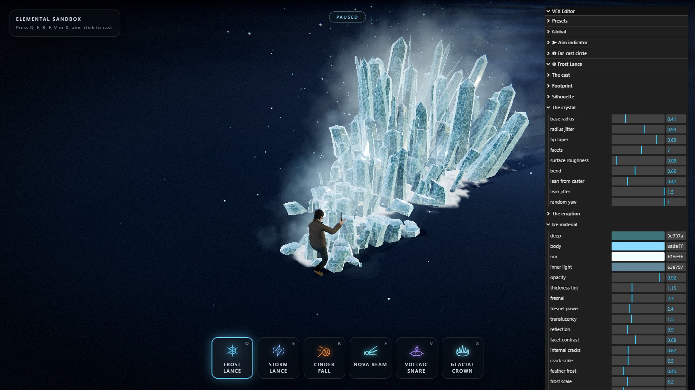

- **Global** multipliers scale everything at once (speed, glow, noise, particles, lights, impact
  intensity, camera shake, time scale…).
- **Aim indicator** — the arrow's silhouette in metres, its outline and fill, the chevrons and
  frost, and the rings and rosette.
- **Far-cast circle** — the boundary band, the interior, the ticks, sweep and reticle, the reach
  ring, and the snap-out. Shared by every far cast, so it is filed with the targeting rather than
  with any one ability.
- **Frost Lance** — the cast, the footprint, the silhouette, the crystal itself, the eruption
  timing, the ice material, the frost on the ground, mist/chips/glitter, the impact and the dynamic
  light.
- **Storm Lance** — the cast, where the bolt leaves the hand, the bundle, one filament, the ribbon,
  flicker and restrike, the bolt's colour, the burns on the ground, sparks/motes/smoke/debris, the
  muzzle and impact, and the dynamic light.
- **Nova Beam** — the cast, where it leaves the hands, the column, the core/sheath/halo stack, the
  surface and its flow, the beam's colour, the coils, the shock discs, the charge and its intake,
  what the floor does, sparks/motes/steam/debris, release/impact/burn, and the two dynamic lights.
- **Voltaic Snare** — the cast and its footprint, the leash, the column, the tendrils, the rim
  arcs, the shared filament shape and flicker, the ribbon and its colour, the field on the floor,
  the burns, sparks/updraft/smoke/debris, throw/snap/hold, and the dynamic light.
- **Glacial Crown** — the crown's blades, the freezing sheet, the thaw and shatter, and the field.
- **Banknote Storm** — the vortex, the notes' flutter and tumble, size and glow, and the light.
- **Implosion** — cooldown/range/min range/zone radius, the charge (cap time), the collapse
  (radius and damage floors and ceilings, burst time and strength), the marker (boundary thickness and
  glow, tick count, spin speed, interior fill, colours) and the light.
- **Tether** — cooldown/range/min range, the channel (tick interval, damage per tick, hit width), the
  arc (core and sheath radii, jitter amount and frequency, noise shatter, anchor radius, colours) and
  the light.
- **Minions** — waves (cap, wave size, interval, spawn radius), movement (speed, crowd range,
  separation, bob and waddle), health and damage (health, damage taken, crits, knockback,
  stagger), death (fall/pause/sink timing, dissolve particles), looks (scale, colours, eyes) and
  the health bars (width, lift, show time, colours).
- **Sound** — the on/off switch, the master, and faders for the cast, impact, combat and UI channels.
  They apply live, so `impact` can be pulled down while a cast is still in the air.
- **Player** — max health, regen rate and delay, hurt invulnerability, move speed, arena radius, walk
  lean and stride swing, plus a **Somersault (Space)** subfolder (dash speed and time, cooldown, dodge
  i-frames, roll time, hop height).
- **Drops** — on/off, the gold floor and ceiling and its lifetime, the magnet and pickup radii, the
  heal-orb chance and amount, and the colours of both drops.
- **Upgrades** — the base cost and the price curve, the per-level gain of each of the four tracks, and
  an **Element reactions** subfolder (on/off, memory window, resonance bonus) holding **Named pairs**
  (a bonus per hand-written pair) and the **Family matrix** (a bonus per family pair, plus four
  read-only rows naming the members).
- **Presets** save to `localStorage`, and can be duplicated, deleted, exported to JSON, imported
  from JSON, or reset to the shipped defaults.

Every ability exposes **every** colour it draws with, and none is derived from another: the crystal
palette, the bolt palette, the beam's four layers and its coils and discs, the ground marks, the
impact shells, the shockwave rings, the screen flashes, and a four-stop lifetime gradient
(`birth → early → late → death`) for each particle system. Tinting the fog without touching the ice,
or cooling the sparks to orange while the filaments stay blue, is a picker away.

Presets are plain snapshots of the settings tree, so an exported file is readable and editable by
hand.

Knobs worth knowing about, because they reshape their ability the most:

- `ice.heightCurve` — how late the ramp climbs; raise it and the field stays low until it explodes
  at the target. `ice.frontBias` below 1 crowds the crystals toward the impact point.
- `thunder.jitter` and `thunder.jitterScale` — how violently the bolt kinks, and how often.
  `thunder.strands` and `thunder.spread` set how wide the bundle reads, and `thunder.restrike`
  how hard it strobes. Those five carry the character of the effect.
- `beam.radius` and `beam.flare` — how heavy the column reads and how hard it opens out where it
  lands. `beam.charge` and `beam.lifetime` are the wind-up and the hold, which are what make this
  ability feel unlike the other three, and `beam.coreWidth` / `beam.coreFill` decide whether the
  layers stay separable or blow out to white.
- `snare.zoneRadius` — the one number the whole far cast is built on. It resizes the targeting
  circle, the tendrils, the rim arcs, the burnt field and the pillar's throat together, live.
  After that, `snare.snapTime` and `snare.height` carry the moment it opens, and `snare.tendrils` /
  `snare.rimArcs` / `snare.strands` decide how much of that footprint is actually lit.
- `zone.boundary` and `zone.snap` — how thick the far-cast circle's edge reads, and how hard it
  overshoots on the way out. Between them they decide whether the indicator feels like a UI overlay
  or like something the caster is doing.
- `minions.health` / `minions.damageTaken` — how long a minion survives and the global difficulty
  dial; together with each ability's `hitDamage` / `tickDamage`, the whole kill cadence is tuned
  here.
- `minions.attack.damage` and `minions.boss.slamRadius` — how hard a bite lands and how wide the
  boss's ring is. The Bite / Ranged / Boss sub-folders carry a full set of sliders for each rhythm,
  from the bite interval to bolt speed to the inflate tell before a slam.
- `implosion.chargeMax` together with `implosion.radiusMax` / `damageMax` — how long the charge takes
  and what it is worth at the top. Push `chargeMax` to four seconds and the ability stops being a tap
  and becomes a wish.
- `tether.tickDamage` and `tether.tickInterval` — how much the channel chews per second and how often;
  `hitWidth` is how thick the line is, which is how easily you can drag the cursor across a whole row
  of minions.
- `drops.magnetRadius` and `drops.healChance` — how eagerly the gold comes to hand, and how often a
  heal orb shows up instead.
- `progression.costGrowth` and `progression.baseCost` — how steep the shop curve is. 1.6× is "it bites
  by the third purchase"; drop it to 1.2 and the road is nearly flat.

---

## Performance notes

- Abilities, decals, bursts and particles are pooled, per type. Twelve casts in a row build at most
  **four** instances of an ability and then stop allocating.
- The whole crystal field is three draw calls regardless of crystal count; the cap is 288.
- A whole bolt is **two** draw calls regardless of filament count; the cap is 24 filaments at 72
  samples each. Nothing about the path touches the CPU, so `strands` is nearly free.
- A whole snare — leash, pillar, tendrils and rim arcs — is **two** draw calls plus one for the
  field, regardless of how many filaments are in it; the cap is 56 across the four roles. As with
  the bolt, none of the shape touches the CPU, so raising `tendrils` or `rimArcs` is nearly free.
  Its targeting circle is two more: one quad and one ring strip.
- A whole beam is **six** draw calls regardless of how many coils and discs are on it — three tube
  passes over one shared geometry, plus one instanced draw each for the coils, the discs and the
  charge orb. As with the bolt, none of the shape touches the CPU, so `coils` and `rings` are
  nearly free. It takes two of the six dynamic lights (the column and the caster's hands), so four
  concurrent beams would exhaust the pool; `LightPool.acquire()` returns null and every use of the
  handle is guarded.
- The six dynamic point lights are created at boot and parked at zero intensity rather than added
  and removed — changing the light count forces three to recompile every material.
- Minions are pooled entities: a full floor of 24 costs ~48 draw calls (body + emissive eyes each,
  geometry merged) plus **one** instanced draw for all the health bars, and one shared dissolve-
  puff system for the swarm; the dead return to the pool with zero garbage. Minion materials join
  the boot-time shader warm-up, so the first wave never hitches.
- The bolts and the loot have pools of their own: 48 bolts (past that a throw is simply dropped) and
  96 drops, each with one shared material. Coins and heal orbs are plain `Mesh`es rather than an
  instanced mesh, so 96 of them on the floor really is 96 draw calls — they only exist while there is
  something to pick up.
- Shadow maps update exactly once per frame even though the scene is rendered several times.
- `renderer.compileAsync()` runs during boot so the first cast never stutters on shader compile.
- Pixel ratio is capped at 1.75; the depth and distortion buffers are half resolution.

Measured on a default cast: 32 draw calls idle, ~69 with a full ice field standing and ~49 with a
bolt in the air, ~1150 live particles. A snare standing with its cage, field and rim burns is ~45
draw calls and ~480 live particles, and arming its circle costs two. Four concurrent casts —
the pool's ceiling, whichever slots they came from — peaks at ~186 draw calls and five of the six
dynamic lights. A full floor of 24 minions adds ~49 more.

Live counters (FPS, live particles, instances, draw calls, minions, kills, wave and gold) are in the
top-right of the HUD.

---

## The archive

`src/archive/` holds the previous incarnation of this project: a four-element bending sandbox
(fire, water, earth, air) cast along a freehand-drawn spline, plus a walk mode that let the avatar
ride the same stroke. None of it is imported by the live app, so Vite never bundles it.

It was retired because this build replaced path drawing with a linear skillshot, which removed the
input every one of those systems was built on. The raymarched flame and water surfaces in
particular are worth mining. See `src/archive/README.md` for what is in there and how to restore a
piece of it.

---

## Known rough edges

- Crystals are drawn with `transparent: true` and `depthWrite: true`. That is the right trade for
  near-opaque ice and it keeps the field from sorting through itself, but at low `ice.opacity` the
  sorting artefacts between overlapping spikes become visible.
- The eruption front is a straight line on a flat floor. Both assumptions are baked in — the ground
  is a single plane at y = 0, and the aim raycast targets that plane. The minion system stands on
  the same assumption (bar anchors and hit tests all live in the XZ plane).
- The distortion pass runs with nothing writing to it. It costs a half-res clear per frame.
- The impact cluster is placed radially around the end point, so at very short cast distances it
  can overlap the band behind it more than it should.
- The far cast inherits the flat-floor assumption twice over: the circle is drawn on a single quad
  at `y = 0`, and the snare's tendrils and rim arcs are placed against that same plane. Neither
  would drape over a step.
- Both the targeting circle and the snare's field are additive, so the footprint brightens the
  floor rather than shading it. On a pale floor the boundary would need a non-additive pass under
  it to stay readable.

---

## Licence

Code is provided as-is for the purposes of this project. The bundled HDR probe, the character FBX
and the banknote scans retain their original licences.
